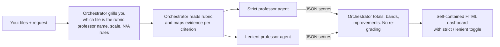

# assignment-grader

A Claude Code skill that grades any assignment against a rubric using two independent professor agents, one strict and one lenient, who never see each other's marks.
It turns their results into a single offline HTML dashboard with a toggle that swaps the whole page between the two lenses.

## Why I built it

One grader gives you one number, and you cannot tell whether it is harsh, generous or fair. Two blind graders show the range a real marker could land in, and where the work is weakest.

## How it works



The two professor agents are launched in the same message, so they run at the same time on identical input and cannot anchor on each other.

## Quick start

Install the skill (Claude Code looks for skills in `~/.claude/skills`):

```bash
git clone <this repo> assignment-grader
mkdir -p ~/.claude/skills
cp -r assignment-grader ~/.claude/skills/assignment-grader
```

Then in Claude Code, from a folder that holds a rubric and a submission:

```
Grade examples/sample-essay.md against examples/sample-rubric.md
```

Claude asks a few clarifying questions, runs the two graders and saves `<assignment>-grade-dashboard.html` next to the files.

To see the dashboard without running any agents, build the demo from the sample scores (Python 3, standard library only):

```bash
python3 examples/render_demo.py
open examples/demo-dashboard.html   # or double-click it
```

## Example output

The demo grades a fictional student essay (Alex Morgan, on whether the fictional Northwind Retail should move its loyalty card into an app) against a fictional four-part rubric. The scores in `examples/sample-grades.json` were written by hand to show the shape of the agents' output.

| Lens | Score | Band |
|------|-------|------|
| Strict | 66 / 100 | Credit |
| Lenient | 81 / 100 | Distinction |

Each criterion card shows the active lens's score, a bar, a one-line reason, and two boxes: what earns marks and what loses marks. The improvements list is tied to the criteria the strict lens marked down. Open `examples/demo-dashboard.html` to try the toggle.

## Design decisions worth noting

- **Blind graders, not one grader with two hats.** Asking a single model for a strict and a lenient score drags both towards the middle. Separate agents with the same input keep the spread honest.
- **The orchestrator never grades.** It only asks questions, prepares the shared input and adds up the numbers, so the scores on the page are exactly what each grader returned.
- **Questions before work.** Most bad grading comes from grading the wrong file or a criterion the submission never claimed to cover. The skill settles file roles, scale and N/A rules first.
- **Structured JSON in, HTML out.** Each grader returns score, earns, loses and a justification per criterion, which makes the dashboard a rendering job rather than a writing job.
- **No fabrication.** Criteria the files cannot support are marked "not assessable" and left out of the total, and that is stated on the page.
- **One file, works offline.** All CSS and JS are inline, the toggle is plain JavaScript with `aria-pressed`, and there is a print style for exporting a PDF.

## Files

| Path | What it is |
|------|------------|
| `SKILL.md` | The skill: the four phases the agent follows |
| `assets/dashboard-template.html` | Structural starting point for the dashboard |
| `examples/sample-rubric.md`, `examples/sample-essay.md` | Fictional inputs |
| `examples/sample-grades.json` | Illustrative output from the two graders |
| `examples/render_demo.py` | Builds the demo dashboard from that JSON |
| `examples/demo-dashboard.html` | The built demo |

Designed and directed by Manoj Tirukoti, built with Claude Code as my pair programmer.
