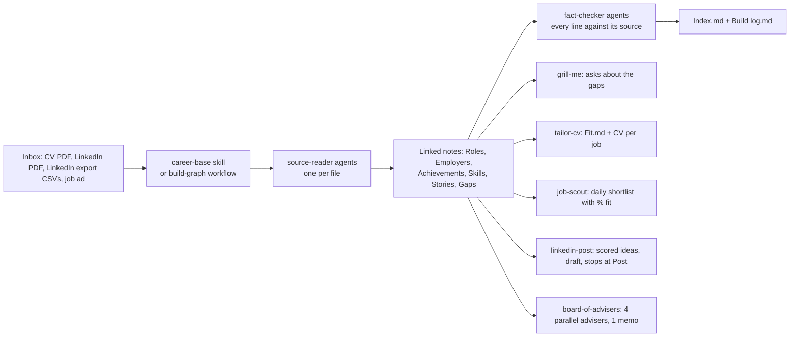

# Career starter kit

A Claude Code project that turns a CV, a LinkedIn PDF and a LinkedIn data export into a linked, source-cited knowledge graph of a career.
From that graph it tailors a CV to a job ad, grills you on what your files leave out, scouts for jobs each morning, drafts LinkedIn posts and tests big decisions with a board of four advisers.

**Why I built it.** Most people paste a CV into a chat window and get back a tailored CV with lines they cannot defend in an interview. I wanted every line to trace back to a file or to something the person actually said.

## What's here

| Folder | What it is |
|---|---|
| `1 Context files/` | Three blank templates (Company, Team, About me) that give any AI tool the context it needs |
| `2 Grill me/` | A prompt that makes the AI interview you before it advises |
| `3 Board of advisers/` | Four advisers test a decision from four angles, then a chair writes a one-page memo. A chat version for any tool and a Claude Code version with subagents |
| `4 My Career/My Career/` | The main project: skills, agents and a workflow that build and use the career graph |
| `4 My Career/test/` | A graph checker, a test harness and the expected facts for the sample person |
| `4 My Career/make-zip.sh` | Packs a clean copy for sharing and refuses if built notes, drafts, scout results or any Inbox file other than the sample are inside |

## How it works



Every fact line ends with its source, for example `(CV p1)` or `(LinkedIn export, Positions.csv row 1)`. When two sources disagree, the build writes a Gap note instead of picking one.

## Quick start

You need the Claude desktop app or Claude Code on a paid plan.

1. Download or clone this repo.
2. Open `4 My Career/My Career` in Claude Code (or the Code tab of the desktop app). Set the permission mode to Accept edits.
3. The Inbox already holds a fictional sample person, Sam Whitlock. Type:
   ```
   Build my career base
   ```
   The quick build takes about 5 to 7 minutes and writes `Index.md`, `Profile.md` and one note per role, employer, achievement, skill and gap.
4. Then try `Tailor my CV to the ad in Inbox`, `Grill me` or `Ask my board of advisers`.
5. To use your own files, delete everything in Inbox that starts with "Sam Whitlock" and add your own CV.

Full steps are in [`4 My Career/My Career/START HERE.md`](4%20My%20Career/My%20Career/START%20HERE.md). Every command is in its README.

### Run the tests

The harness copies the project to a temp folder, runs each command headless with the `claude` CLI, then checks the graph.

```bash
cd "4 My Career/test"
./run-tests.sh            # build, tailor, scout setup, quick scout, then graph checks
./run-tests.sh rerun      # builds twice, checks nothing was duplicated
./run-tests.sh swap       # swaps in a second made-up CV, checks the first moved to Old builds
python3 -I check_graph.py "<path to a built My Career folder>"
```

`sam-expected-facts.md` lists every fact in the sample files and the traps planted in them (a date clash, a title that differs between CV and LinkedIn, a fact found in one source only), so a tester can see whether the build caught them.

## Example output

A real quick build on the sample (about 7 minutes) wrote 44 notes: 5 roles, 4 employers, 7 achievements, 9 skills, 8 gaps, 2 themes and the rest. One role note, trimmed:

```markdown
---
type: role
key: role/fernmoor-water/head-of-customer-operations
person: Sam Whitlock
checked: flagged
employer: "[[Fernmoor Water]]"
title: Head of Customer Operations
start: 2021-03
end: present
title_disagrees: no
dates_disagree: no
---
# Fernmoor Water - Head of Customer Operations

- Title: Head of Customer Operations (CV p1, LinkedIn PDF p1, LinkedIn export, Positions.csv row 1)
- Reported to: the Chief Customer Officer (CV p1)
- Team: 140 staff (CV p1)
- Budget: $18M operating budget (CV p1)

## Achievements
- [[Cut written complaints]]
- [[Set up the first customer vulnerability team]]

## Gaps
- [[Gap - Written complaints result]]
- [[Gap - Fernmoor Water facts in one source only]]
```

Then the graph checker prints one line per rule and per planted trap:

```
PASS  Every fact line ends with a (source) citation, gap: or check:
PASS  Trap 2: Calder title shown both ways, title_disagrees: yes, one Gap note
PASS  Trap 3: '31%' (CV) and 'almost a third' (LinkedIn) both kept, nothing rounded
PASS  Trap 8: the recommender's name appears in no note
```

## Design decisions worth noting

- **Sources on every line.** A fact without a source is not written. Disagreements become Gap notes that Grill me asks about later.
- **Independent checkers.** The full build runs reader, writer and fact-checker agents in a workflow, so the agent that wrote a note never marks its own work. `build-graph.js` is a script for Claude Code's Workflow tool, not a Node program, so it only runs inside that tool.
- **Advisers work blind.** The four board members run in parallel and never see each other's views. The chair only synthesises.
- **Claude drafts, people act.** It never posts, applies or sends. The LinkedIn flow fills the composer and stops at the Post button.
- **Privacy by default.** The project's `.gitignore` keeps Inbox, built notes, drafts and preferences out of any repo made from it. `make-zip.sh` refuses to package a folder with built notes, drafts, scout results or any Inbox file other than the Sam Whitlock sample.
- **Plain English is checked, not hoped for.** The checker fails a build that uses em dashes or semicolons, and every outward draft goes through a plain-English pass that may not change a fact.
- **Tests against a made-up person.** Sam Whitlock and every employer, school and club in the sample are invented, with deliberate traps to catch a sloppy build.

## A note on the sample data

Sam Whitlock, Fernmoor Water, Calder Freight, Bellmere Insurance, Kestrel Bay Energy, Ridgeway Business School, Eastgate University and Bellbird Junior Football Club are all fictional. Any likeness to a real person or organisation is chance.

The project's own `.gitignore` ignores `Inbox/` and the blank LinkedIn and Job Scout notes so users never commit their own data. That means the sample files and blank stubs in this repo were added with `git add -f`.

## Licence

MIT. See [`LICENSE`](LICENSE).

---

Designed and directed by Manoj Tirukoti, built with Claude Code as my pair programmer.
