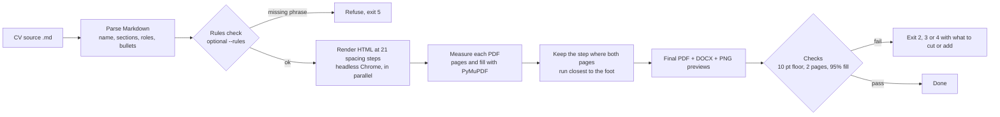
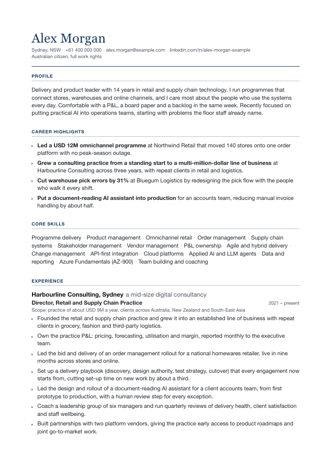
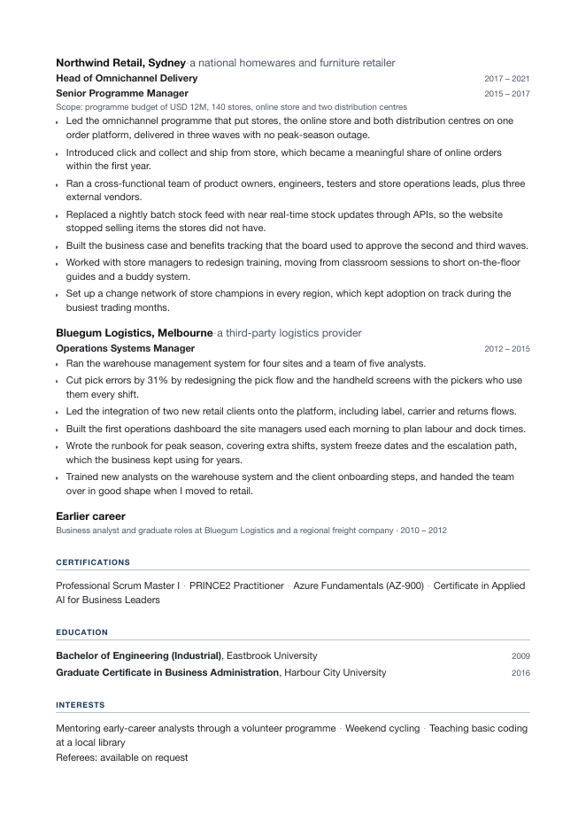
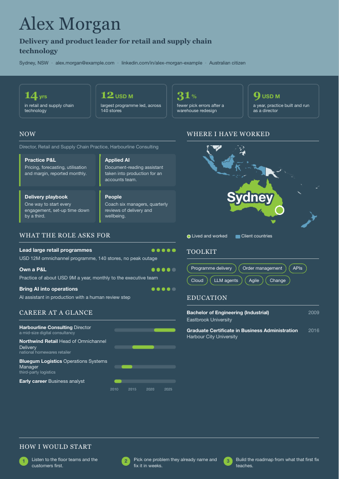

# cv-builder

Turns a CV written in plain Markdown into a designed two-page PDF, a Word copy and preview images, with checks that stop a bad CV before it goes out.
A second script turns a small JSON spec into a one-page visual "dashboard" CV with number tiles, a career timeline and a world map.

## Why I built it

Tailoring a CV for every application meant fighting Word margins and font sizes each time, and the result was often a page and a half, tiny type or a layout that applicant tracking systems read out of order. I wanted to write the content once in Markdown and have a tool own the layout and the rules.

## How it works



The dashboard builder reuses the same Chrome renderer and previews. It draws the map as inline SVG from Natural Earth country outlines with a simple equirectangular projection, so there is no map service or API key.

## Quick start

You need Python 3.10 or later, Google Chrome (or Chromium) and Poppler.

```bash
# macOS
brew install poppler
# Debian or Ubuntu
sudo apt install poppler-utils chromium

pip install -r requirements.txt

# the two-page text CV, with the sample descriptor rule
python3 build_cv.py examples/alex-morgan-cv.md --rules examples/rules.json

# the one-page dashboard CV
python3 build_dashboard.py examples/alex-morgan-dashboard.md

# fast tests (no Chrome needed)
python3 -m unittest discover tests
```

If Chrome is somewhere unusual, point to it with `CHROME_PATH=/path/to/chrome`.

Outputs land next to the source with the same base name: `.html`, `.pdf`, `.docx` (text CV only) and `.preview-N.png`.

## Example output

Built from the fictional sample in `examples/` (Alex Morgan and every company in it are made up).

```
spacing: line height 1.4, gaps x3.0 (spread 1.00 of 1, chosen so every page runs to the foot)
pdf:  examples/alex-morgan-cv.pdf  (2 pages)
body text as printed: 10.0 pt
words: 818 (budget 1150)
page fill: page 1 99% · page 2 98% (each must reach 95%)
```

| Text CV, page 1 | Text CV, page 2 | Dashboard CV |
|---|---|---|
|  |  |  |

The full sample PDF is in `docs/sample-cv.pdf`.

## Writing a CV source

```markdown
# Name
City · phone · email · link · work rights

## Section
### Organisation, City | short descriptor
**Job title** · 2021 – present
Scope line, shown small and grey
- Bullet, **bold** allowed
<!-- page break -->
---
Anything after the first rule is ignored (held-back notes).
```

Front matter at the top is ignored. A `### ` line starts a role block, the last ` · ` segment of a bold row is right-aligned as the dates, and a section whose title contains "skill" gets a looser line height.

## Design decisions worth noting

- **Cut, never shrink.** Body text has a 10 pt floor. The build refuses a smaller size, and it reads the printed font size back out of the PDF to catch Chrome quietly scaling the page down (exit 3).
- **Both pages full.** Instead of one fixed layout, it renders 21 spacing steps between a tight design and the airiest allowed, measures where the text ends on every page, and keeps the step where both pages reach the foot. A CV that still stops short fails (exit 4) with a nudge to add a true line, not more air.
- **Margins are fixed at 2 cm.** There is no flag to narrow them, on purpose.
- **Exit codes are a contract.** 2 means too long, 3 means the type was shrunk, 4 means too short, 5 means a required descriptor is missing. That makes it easy to drive from a script or an agent.
- **No check runs silently off.** If PyMuPDF, Poppler or Chrome is missing, the build stops before it starts rather than skipping a check.
- **ATS-friendly output.** One column, no tables or icons, ligatures turned off so parsers do not misread "fi" and "fl", and stacked job titles keep their dates beside them in the extracted text.
- **Optional descriptor rules.** `--rules` takes a JSON file listing organisations that must always carry a set phrase, so a wording you have agreed to use is never dropped from a tailored copy.
- **Word copy from the same parse.** The DOCX is built from the same parsed structure with python-docx, so the two never drift apart.

## Project layout

```
build_cv.py            two-page text CV: parse, fill search, render, checks, DOCX
build_dashboard.py     one-page dashboard CV from a JSON spec
assets/                Natural Earth country outlines (public domain)
examples/              fictional CV source, dashboard spec and rules file
docs/                  sample outputs built from the fictional data
tests/                 unit tests for the parser, rules and spacing helpers
```

## Credits

Country outlines from [Natural Earth](https://www.naturalearthdata.com), public domain.

Designed and directed by Manoj Tirukoti, built with Claude Code as my pair programmer.

Licence: MIT.
