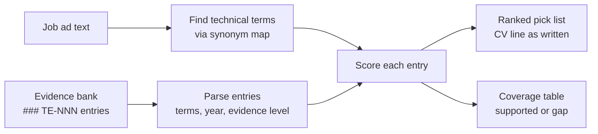

# tech-picker

Reads a job ad and a Markdown bank of your past technical work, then ranks the entries that honestly back up what the ad asks for.
Every technical term in the ad ends up either supported by named evidence or marked "gap: do not claim".

## Why I built it

Tailoring a CV for a technical role meant rereading years of old CVs and project notes for every ad, and it was too easy to stretch a claim to match a keyword.

## How it works



Score for each entry:

```
score = sum over covered terms of (1 + min(times in ad, 5) / 5)
        x evidence weight      (reference 1.0 ... cv-claim 0.7, conflict 0.4, unsupported 0)
        x recency              (1.0 for 2011, rising to 1.5 for 2026)
```

## Quick start

Python 3.8 or later, standard library only. Nothing to install.

```bash
git clone <this repo> && cd tech-picker
python3 pick.py examples/job_ad.md --top 8
python3 pick.py --terms "microservices, APIs, POS, Python"
python3 pick.py path/to/ad.txt --bank path/to/your_bank.md --out pick.md
```

The sample bank belongs to Alex Morgan, a fictional engineer. The companies in it (Northwind Retail Systems, Contoso Consulting, Harbourline Outfitters) are made up too.

## Example output

From `python3 pick.py examples/job_ad.md --top 8` (full file in `examples/pick_output.md`):

```
## Ranked evidence

1. **TE-002 Click and collect for 40 stores** (Northwind Retail Systems, 2023) score 12.0
   - CV line: Led the integration that let online orders be picked up in store, ...
   - Covers: ecommerce, cloud / Azure, POS, C# / .NET, omnichannel retail, integration
...
6. **TE-004 Returns assistant prototype** (Northwind Retail Systems, 2025) score 4.2  (self-asserted: use the wording as given)
   - Open question: Was the test set accuracy written down anywhere?

## Coverage of the ad's terms

| Term | In ad | Supported by |
|---|---|---|
| APIs | 4 | TE-001, TE-010 |
| DevOps / CI-CD | 2 | TE-008 |
| algorithms | 2 | **gap: do not claim** |
```

## Bank format

One entry per `### TE-NNN Title` heading, with bullet fields:

```markdown
### TE-001 Order API for the online store
- **Employer:** Northwind Retail Systems
- **When:** 2024
- **Tech:** C#, ASP.NET, REST, SQL
- **Keywords:** api, ecommerce, headless storefront
- **CV:** Part of the team that designed the REST order API ...
- **Evidence:** `document` (design document, sign-off email)
- **Ask:** optional open question to settle before using it
```

## Design decisions worth noting

- **The CV line is never strengthened.** The tool prints the bank's own wording. Ranking decides what to lead with, not how big to make it.
- **Gaps are reported, not hidden.** A term no entry supports shows as "gap: do not claim", so the honest answer is the default.
- **Evidence strength is part of the score.** An entry backed by a reference letter outranks the same claim found only in an old CV. `unsupported` entries stay in the bank so nobody adds them again, but are never picked.
- **Weak evidence is flagged in the output.** `cv-claim`, `conflict` and `self-asserted` entries carry a warning, so a person checks them before they leave the building.
- **A hand-built synonym map, not embeddings.** "Commerce Scale Unit" counts as microservices and "till" counts as POS because someone who knows the domain said so. A synonym only belongs in the map if doing one really is doing the other. It is small, readable and easy to argue with.
- **Recency matters, but gently.** A 2026 entry gets at most 1.5 times the weight of a 2011 one, so old but strong evidence still shows up.
- **Notes in the ad file are ignored.** Anything after a `## Notes` heading is not scored, so you can annotate an ad without skewing the result.
- **No dependencies.** One file, standard library only, runs in well under a second.

## Licence

MIT. See `LICENSE`.

Designed and directed by Manoj Tirukoti, built with Claude Code as my pair programmer.
