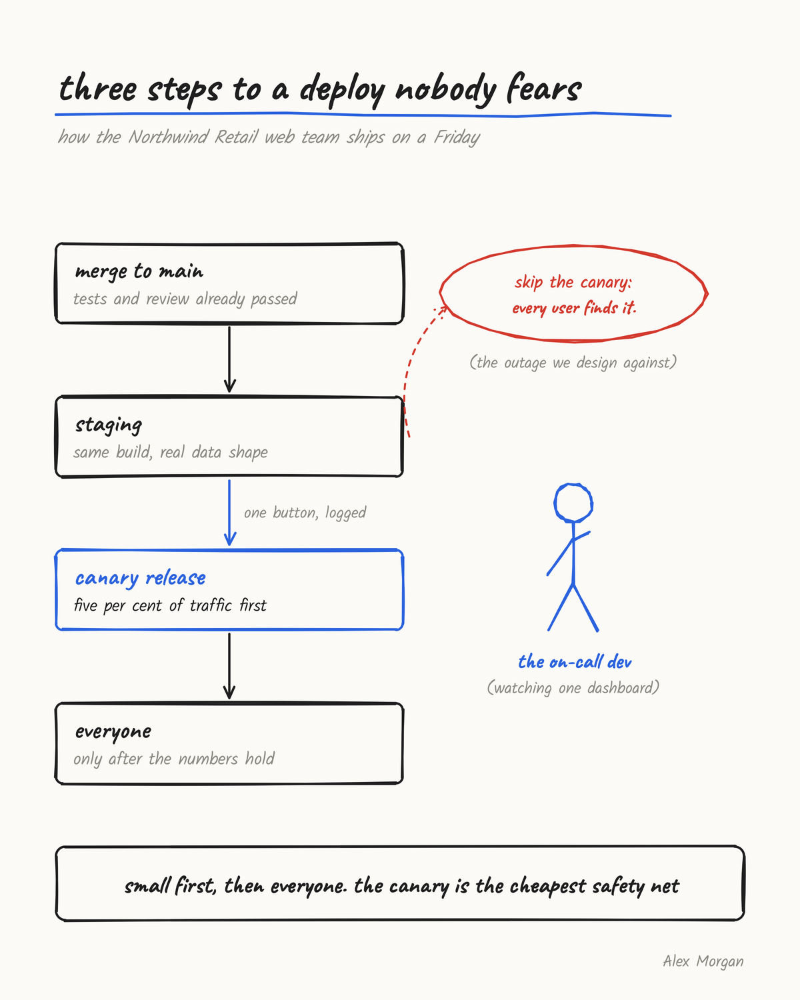
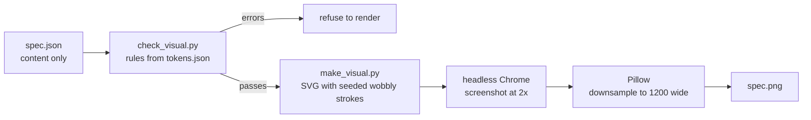
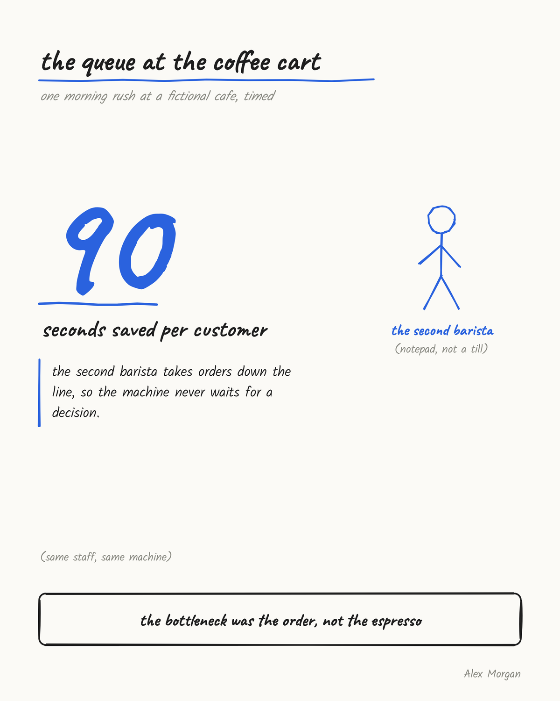
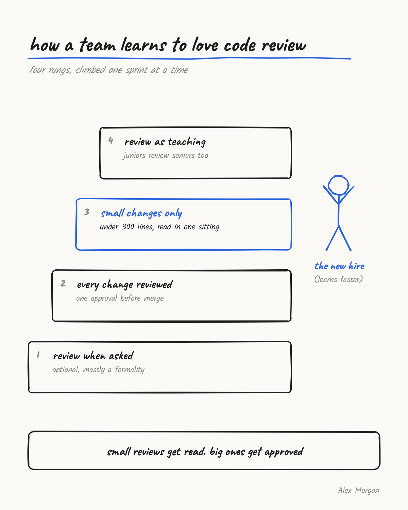
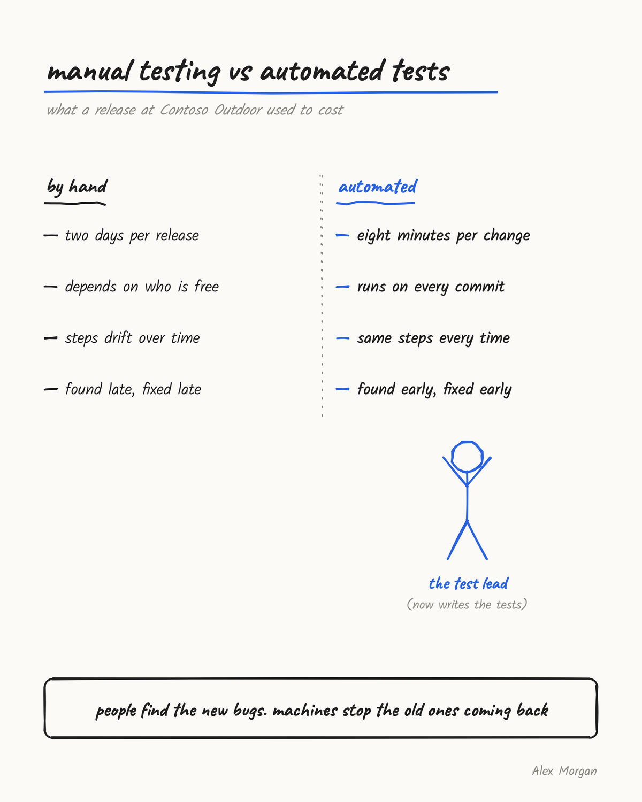

# Whiteboard visuals

Turns a ten-line JSON spec into a hand-drawn "whiteboard" image for a social post, 1200 by 1500 pixels.
A checker enforces the design system first, so every image looks like it came from the same pen.



## Why I built it

Post images made by hand took me longer than the post itself, and no two looked alike. I wanted one consistent visual voice where I only write the content and the design stays fixed.

## How it works



- `tokens.json` holds the whole design: five colours, two fonts, sizes, stroke widths, layout, text limits and the grammar rules.
- `check_visual.py` lints a spec against those tokens. It catches text that is too long, banned characters, more than one highlighted element, missing title or takeaway.
- `make_visual.py` draws the picture as SVG. Every line is a slightly bowed double stroke, so it reads as hand-drawn. The randomness is seeded from a hash of the spec, so the same spec always gives the same image.
- Four layouts: `boxes` (a flow), `number` (one big figure), `ladder` (steps up) and `compare` (two columns).

## Quick start

You need Python 3.12 or later and Google Chrome or Chromium (used headless, no internet needed).

```bash
pip install -r requirements.txt
python3 check_visual.py examples/number.json      # lint only
python3 make_visual.py examples/number.json       # writes examples/number.png
python3 -m unittest discover tests                # 8 tests, no Chrome needed
```

Options: `--out file.png`, `--square` for 1200 by 1200, `--keep-html` to keep the intermediate page, `--chrome PATH` (or set `CHROME_PATH`) when Chrome is not in a standard place.

## Example

This spec:

```json
{
  "type": "number",
  "title": "the queue at the coffee cart",
  "subtitle": "one morning rush at a fictional cafe, timed",
  "value": "90",
  "unit": "seconds saved per customer",
  "how": "the second barista takes orders down the line, so the machine never waits for a decision.",
  "person": {"pose": "walk", "label": "the second barista", "aside": "notepad, not a till"},
  "asides": ["same staff, same machine"],
  "takeaway": "the bottleneck was the order, not the espresso",
  "signature": "Alex Morgan"
}
```

renders as:

| number | ladder | compare |
|---|---|---|
|  |  |  |

All the sample people, companies and figures are fictional.

## Spec reference

Every type takes `title` (required), `subtitle`, `takeaway` (required), `asides` (up to two), `signature` (defaults to `signature_default` in `tokens.json`), `person` (`pose`, `label`, `aside`, poses `down`, `up`, `tap`, `walk`, `think`) and `risk` (`head`, `body`, `aside`, `from`). Exactly one element carries `"matters": true` and is drawn in blue.

| type | required | notes |
|---|---|---|
| `boxes` | `boxes` (2 to 4 of `id`, `label`, `line`, `matters`), `arrows` (`from`, `to`, `label`) | `layout` is `stack` (default) or `row`. `risk.from` names the box the dotted red arrow leaves. |
| `number` | `value` (up to 4 characters), `unit` | `how` is the one-line mechanism. The number is the blue element. |
| `ladder` | `steps` (3 to 5 of `label`, `line`, `matters`), listed bottom to top | The person stands beside the blue step. |
| `compare` | `left`, `right` (`title`, `items`, `matters`) | The person stands under the blue column. |

Text limits in characters: title 48, subtitle 60, label 22, line 44, aside 40, arrow label 34, takeaway 80, step 32, step line 40, compare head 26, compare item 34, person label 22, risk head 22, risk body 24, how 100. Banned anywhere: em dash, semicolon, `#`, `http`, `!!`, sparkle emoji.

## Design decisions worth noting

- **Design as data, content as data, never mixed.** A spec cannot set a colour or a size. To change the look you change `tokens.json`, once, for every image.
- **A linter in front of the renderer.** The render refuses a spec with errors, so an off-system image cannot be produced by accident. The checker cannot see overlap, so you still look at the PNG.
- **One blue thing.** The grammar allows exactly one highlighted element per picture, which forces the author to decide what the point is.
- **Deterministic randomness.** The wobble is seeded from the spec, so re-running a build gives an identical file and diffs stay quiet.
- **Browser as the typesetter.** Chrome renders the SVG with the real fonts at 2x and Pillow downsamples. That gives proper kerning and anti-aliasing without a heavy graphics library.
- **Fonts bundled.** It works offline and renders the same on any machine.

## Files

- `make_visual.py`: the renderer
- `check_visual.py`: the design-system checker
- `tokens.json`: the design system
- `examples/`: one spec and its render per type
- `tests/`: checker and determinism tests
- `fonts/`: Caveat and Kalam, with `LICENCE.md` and the full `OFL.txt`

## Credits

Fonts: Caveat by Pablo Impallari and Kalam by Indian Type Foundry, both under the SIL Open Font License 1.1 (see `fonts/`).

Designed and directed by Manoj Tirukoti, built with Claude Code as my pair programmer.
